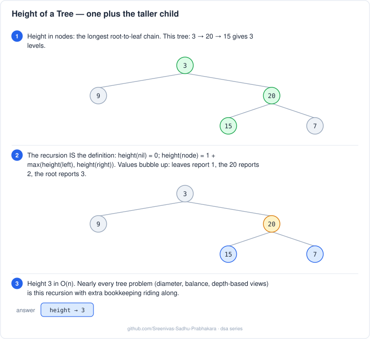

# Height of a Binary Tree

> Striver SDE Sheet 117 · Day 18 Binary Tree II — one more than the taller subtree; the base case does all the work. Go, stdlib only, tested.

## Problem

The height (maximum depth) of a binary tree, counted in nodes along the longest root-to-leaf path; an empty tree has height 0.

## Approach

The definition is already the algorithm: `height = 1 + max(height(left), height(right))`, with nil contributing 0. Three lines, and the template for half the tree problems that follow — diameter (#118), balance checking (#119) and max path sum (#124) are all this recursion carrying one extra piece of information upward. Two conventions exist in the wild (count nodes vs count edges, differing by one); this repo counts nodes and says so, because interviews lose more points to convention mismatches than to wrong algorithms.

**Complexity:** O(n) time, O(h) recursion.

## Visual walkthrough

Read the picture top to bottom — each numbered frame is one moment of the algorithm
running on this repo's test example.

## Run

    go test ./...   # verify
    go run .        # demo

---

One of 191 repos solving Striver's SDE Sheet in Go — stdlib only, one problem per repo, every solution tested. Browse the set: [`dsa-*` repos](https://github.com/Sreenivas-Sadhu-Prabhakara?tab=repositories&q=dsa-&type=source).
